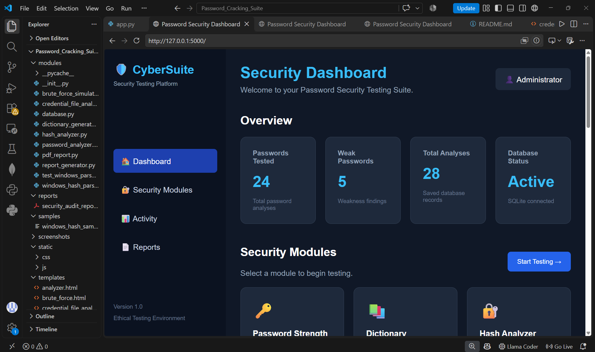
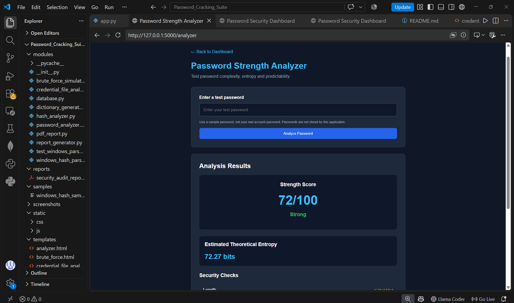
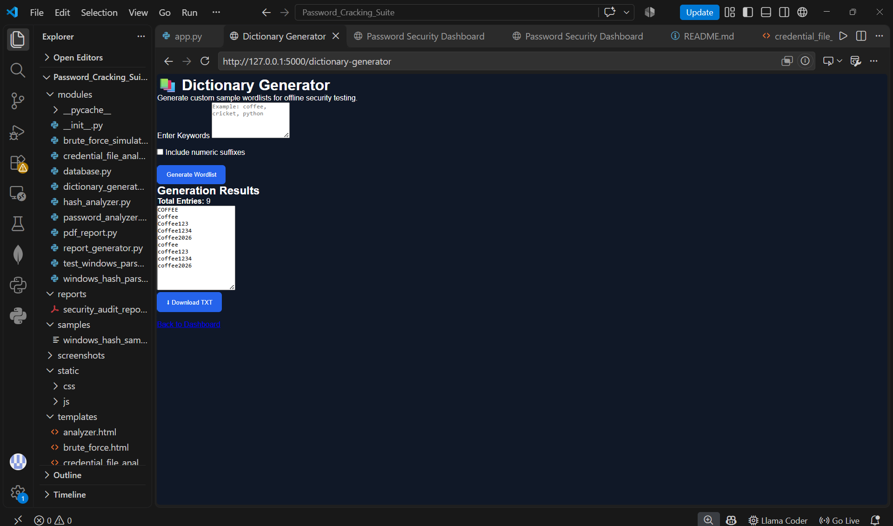
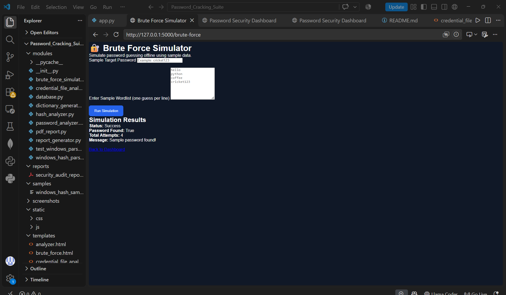
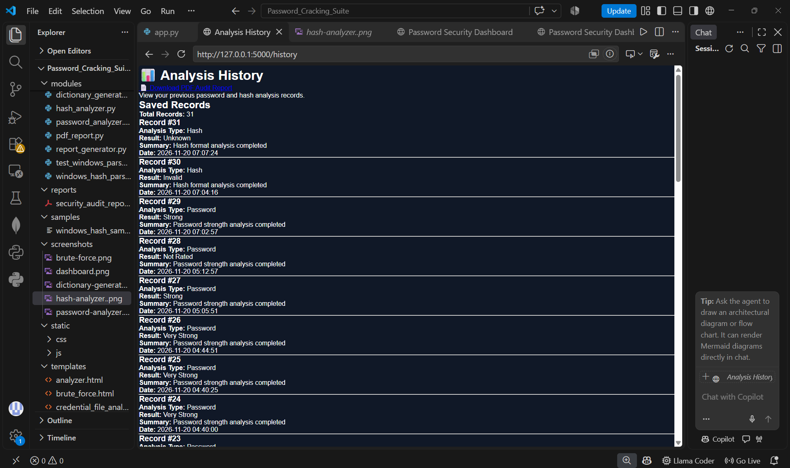

# Password Cracking & Credential Attack Suite

## Project Overview

The Password Cracking & Credential Attack Suite is a cybersecurity educational project developed using Python and Flask.

The application provides multiple modules to analyze password security, examine hash formats, generate dictionary wordlists, simulate bounded brute-force attacks, and analyze sample credential records.

It also provides a dashboard, analysis history, SQLite database integration, and PDF audit reports.

## Project Objectives

- Understand password security and common credential attacks.
- Analyze password strength and security weaknesses.
- Learn about password hashes and credential formats.
- Simulate dictionary-based and brute-force attacks in a controlled environment.
- Generate security audit reports.
- Practice Python programming and web application development.

## Key Features

- Password Strength Analyzer
- Hash Analyzer
- Dictionary Generator
- Brute-Force Simulator
- Linux Shadow File Analyzer
- Windows SAM Analyzer
- Windows Account Hash Parser
- SQLite Analysis History
- Dashboard with Analysis Statistics
- PDF Audit Report Generation

## Technologies Used

- Python
- Flask
- SQLite
- HTML
- CSS
- JavaScript
- PDF report generation

## Technology Details

| Technology | Purpose |
|---|---|
| Python | Core programming language used to develop the project logic and security analysis modules. |
| Flask | Used to build the web application and handle user requests and responses. |
| SQLite | Stores analysis history and dashboard statistics. |
| HTML | Creates the structure of the web pages. |
| CSS | Handles the visual design and layout of the dashboard. |
| JavaScript | Adds client-side functionality and interactions. |
| PDF Generation | Creates downloadable security audit reports. |

## Development Environment

- Code Editor: Visual Studio Code
- Operating System: Windows
- Browser: Microsoft Edge / Google Chrome
- Local Development Server: Flask

## Installation and Setup

### Prerequisites

- Python 3.x
- Visual Studio Code (recommended)
- Git (optional)

### Step 1: Clone the Repository

```bash
git clone YOUR_GITHUB_REPOSITORY_URL
```

### Step 2: Open the Project Folder

```bash
cd Password-Cracking-Credential-Attack-Suite
```

### Step 3: Create a Virtual Environment

```bash
python -m venv venv
```

### Step 4: Activate the Virtual Environment

For Windows:

```bash
venv\Scripts\activate
```

### Step 5: Install Dependencies

```bash
pip install Flask reportlab
```

### Step 6: Run the Application

```bash
python app.py
```

### Step 7: Open the Dashboard

Open your browser and visit:

```text
http://127.0.0.1:5000/
```

The application dashboard should now be available locally.

## Project Status

The application development and initial testing have been completed.

## Disclaimer

This project is intended for educational and authorized security testing purposes. Use synthetic sample data and do not use real credentials or unauthorized credential files.
## Project Modules

### 1. Password Strength Analyzer
Evaluates password strength based on length, uppercase and lowercase letters, numbers, special characters, and other security checks.

### 2. Hash Analyzer
Identifies possible hash formats, such as MD5, SHA-1, SHA-256, and SHA-512, based on hash characteristics.

### 3. Dictionary Generator
Creates sample wordlists using user-provided keywords and common variations.

### 4. Brute-Force Simulator
Simulates a bounded brute-force attack using a limited sample wordlist to demonstrate password-guessing concepts.

### 5. Linux Shadow File Analyzer
Analyzes synthetic Linux shadow-file records and identifies relevant account and password-hash information.

### 6. Windows SAM Analyzer
Examines synthetic Windows SAM-style account records for educational analysis.

### 7. Windows Account Hash Parser
Parses sample Windows account records and extracts account-related information.

### 8. SQLite Database
Stores analysis history, including analysis types, results, summaries, and timestamps.

### 9. Dashboard
Displays application statistics and recent analysis activity.

### 10. PDF Report Generator
Generates downloadable PDF audit reports containing analysis information.

## Project Screenshots

### 1. Dashboard


### 2. Password Analyzer


### 3. Hash Analyzer


### 4. Dictionary Generator


### 5. Brute-Force Simulator


### 6. Analysis History


### 7. PDF Audit Report


## Testing and Validation

The application was tested to verify the functionality of all major modules.

### Testing Results

| Test Case | Expected Result | Status |
|---|---|---|
| Password Strength Analysis | Correctly identifies password strength | Passed |
| Empty Password Validation | Displays validation message | Passed |
| Long Password Validation | Rejects passwords exceeding 256 characters | Passed |
| Hash Analysis | Identifies possible hash formats | Passed |
| Dictionary Generation | Generates sample wordlists | Passed |
| Brute-Force Simulation | Performs bounded password-guessing simulation | Passed |
| Linux Shadow Analysis | Analyzes synthetic Linux records | Passed |
| Windows SAM Analysis | Analyzes synthetic Windows records | Passed |
| Database Integration | Saves analysis history | Passed |
| PDF Report Generation | Generates downloadable PDF reports | Passed |
| Dashboard Integration | Displays application statistics | Passed |

### Error Handling

- Empty input validation
- Invalid input detection
- Maximum input length validation
- Record and wordlist size limits
- Error messages for invalid data

All listed tests were completed successfully during project testing.